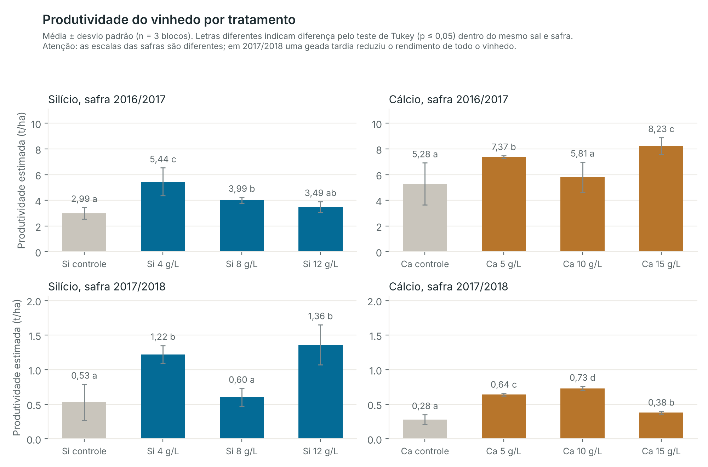
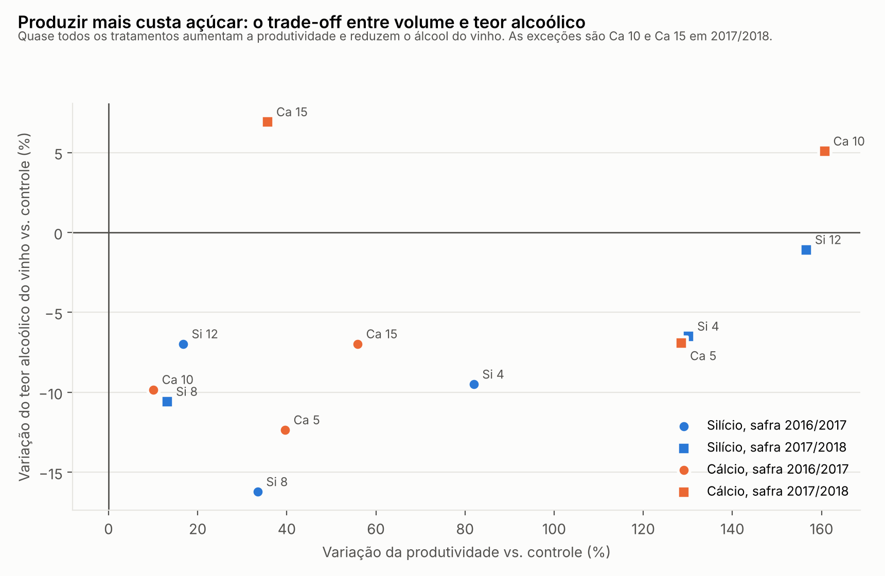
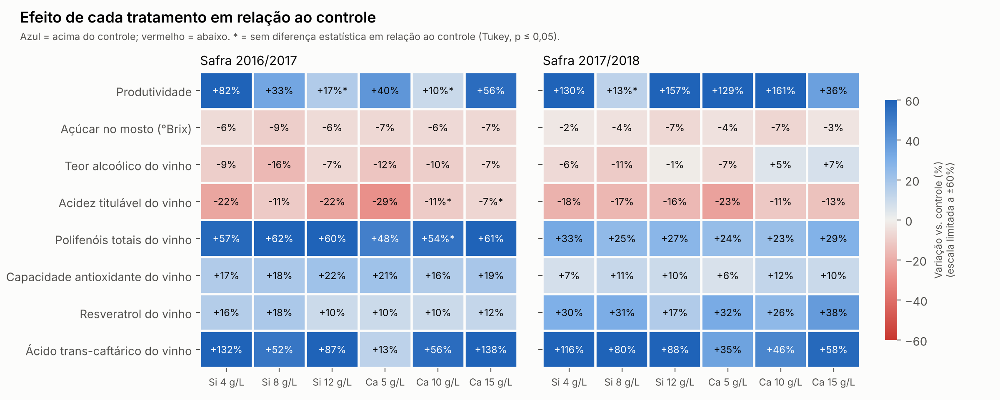
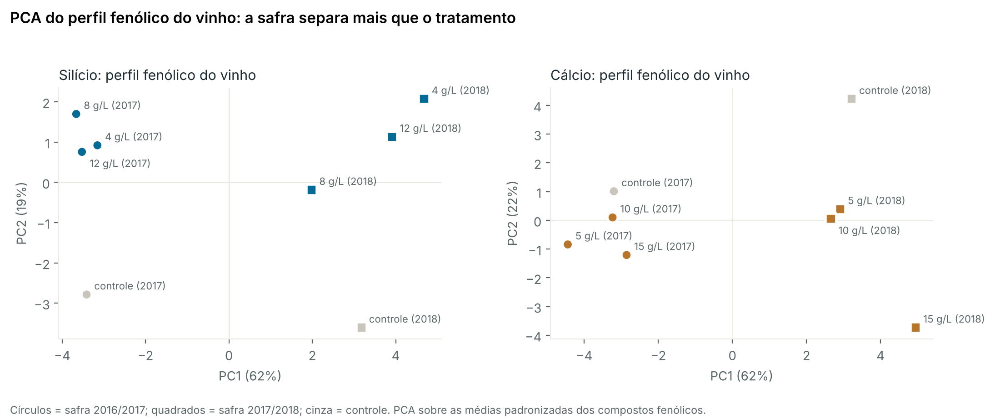

# Fertilizantes naturais no vinhedo: vale a pena produzir mais?

Análise de dados de um experimento de campo com uvas Sauvignon Blanc, construída a partir da minha tese de doutorado (UFSC, 2020). O projeto transforma tabelas científicas em um banco de dados relacional, responde perguntas de negócio com SQL e Python e reproduz a estatística original.

**Pergunta de negócio:** aplicar silício ou cálcio no cacho da uva aumenta a produtividade do vinhedo? E, se aumenta, qual é o custo para a qualidade do vinho?

**📊 [Abrir o dashboard interativo](https://trilicia.github.io/fertilizantes-naturais-vinhedo/)**

O desenho é o de um **teste A/B com várias doses**: cada fertilizante tem um grupo controle e três doses, em 3 blocos de 10 plantas, repetidos em duas safras.

---

## Principais resultados



- **Silício na menor dose (4 g/L) foi o tratamento mais consistente:** aumentou a produtividade nas duas safras, com diferença estatística (+82% em 2016/2017, de 2,99 para 5,44 t/ha; +130% em 2017/2018, de 0,53 para 1,22 t/ha).
- **Apenas 3 dos 6 tratamentos tiveram ganho significativo nas duas safras:** Si 4 g/L, Ca 5 g/L e Ca 15 g/L. Os demais funcionaram em uma safra e não na outra.
- **O ranking muda com o clima.** Em 2017/2018, uma geada tardia derrubou o rendimento de todo o vinhedo. O Ca 15 g/L, campeão da primeira safra (8,23 t/ha), ficou atrás do Ca 5 e do Ca 10 na segunda.



- **Produzir mais custa açúcar.** Todos os tratamentos reduziram os sólidos solúveis do mosto (de 2% a 9,5%), e quase todos reduziram o teor alcoólico do vinho (até 16%). As exceções foram Ca 10 e Ca 15 g/L em 2017/2018.
- **Em compensação, o vinho ganhou compostos funcionais:** polifenóis totais de +23% a +62%, capacidade antioxidante de +6% a +22% e resveratrol de +10% a +38% em relação ao controle.



### Recomendação

Para um produtor que quer **aumentar o volume com o menor risco**, a opção mais defensável é o **silício a 4 g/L**: é a menor dose (menor custo de insumo), foi a única de silício com ganho significativo nas duas safras e ainda elevou os polifenóis e o resveratrol do vinho. O ponto de atenção é a redução de cerca de 6% a 10% no teor alcoólico, que precisa ser avaliada conforme o estilo de vinho desejado.

A decisão final depende de dados que o experimento não tem: **preço da uva por kg e custo de aplicação**. O próximo passo seria uma análise de retorno com esses valores e um piloto em uma área maior.

---

## O que este projeto demonstra

| Etapa | O que foi feito |
|---|---|
| **Extração** | Leitura do PDF da tese e conversão de 4 tabelas em 1.048 medições em formato longo (`scripts/01_extract_tables.py`) |
| **Qualidade de dados** | Auditoria da fonte: doses descritas de formas diferentes, linhas duplicadas, unidade suspeita (ver abaixo) |
| **Modelagem** | Banco SQLite em modelo estrela: tratamentos, variáveis, safras, etapas e uma tabela de fatos (`scripts/schema.sql`) |
| **SQL** | View de comparação com o controle e 6 perguntas de negócio (`sql/consultas.sql`) |
| **Estatística** | ANOVA de um fator e Tukey HSD **reconstruídos a partir de média, desvio padrão e n**, sem os dados brutos; PCA do perfil fenólico |
| **Comunicação** | Gráficos, placar de tratamentos e um [dashboard interativo](https://trilicia.github.io/fertilizantes-naturais-vinhedo/) com filtros de safra e fertilizante (`scripts/04_build_dashboard.py`) |

### Reprodução da estatística original

Refiz 211 ANOVAs e 1.188 comparações de Tukey usando apenas as médias e os desvios publicados. **Em 86% das comparações**, a conclusão (difere ou não difere) foi a mesma da tese. Quando discordam, a reconstrução tende a ser mais conservadora: os desvios publicados estão arredondados (vários aparecem como 0,00), o que limita a precisão do cálculo.



A PCA mostra que **a safra separa mais as amostras do que o tratamento** (o primeiro componente explica 62% da variação e divide 2017 de 2018). Dentro de cada safra, os vinhos tratados se afastam do controle.

---

## Validação cruzada com o artigo publicado

Os resultados deste capítulo foram publicados em **Gomes et al. (2020), *Journal of the Science of Food and Agriculture*, 100(4), 1547–1557** ([DOI 10.1002/jsfa.10163](https://doi.org/10.1002/jsfa.10163)). Comparei a minha reanálise com as conclusões do artigo:

| Ponto | Artigo (2020) | Esta análise |
|---|---|---|
| Doses | 0, 4, 8 e 12 g/L de metassilicato de sódio; 0, 5, 10 e 15 g/L de cloreto de cálcio | Mesma padronização, que resolveu as inconsistências encontradas no texto da tese |
| Tratamentos promissores | Si 4 g/L, Si 8 g/L e Ca 15 g/L | **Concorda** com Si 4 g/L e Ca 15 g/L, os dois com ganho significativo de produtividade nas duas safras |
| Si 8 g/L | Indicado como promissor | Teve o maior aumento de polifenóis do vinho em 2016/2017 (+62%), mas **não diferiu do controle em produtividade em 2017/2018** (0,60 vs 0,53 t/ha) |
| Ca 5 g/L | Não destacado | Também teve **ganho significativo nas duas safras** (+40% e +129%) |

As diferenças vêm do critério: o artigo pondera produtividade e qualidade fitoquímica juntas, e esta análise dá mais peso à **consistência da produtividade entre safras**, que é a pergunta de um produtor que precisa decidir onde investir.

**Influência do artigo:** 26 citações (consulta em novembro de 2026). Ele é citado em revisões internacionais sobre o papel do silício nas plantas e sobre a qualidade da uva, e em estudos de outros países, como Bulgária e China.

---

## Auditoria de qualidade dos dados

Encontrei e documentei inconsistências na fonte. Todas estão registradas na tabela `auditoria_qualidade` do banco.

| Tema | Problema | Decisão |
|---|---|---|
| Doses | As doses aparecem de formas diferentes na metodologia e nas tabelas (por exemplo, Si 1,2% e 1,4%; Ca "1,5 g/L" e 1,5%) | Padronizado como Si 4/8/12 g/L e Ca 5/10/15 g/L, **confirmado pela autora e pelo artigo publicado** |
| Linhas duplicadas | Dois pares de compostos têm valores idênticos em todas as colunas (provável erro de transcrição) | Mantidos no banco, marcados com `flag_qualidade` e excluídos das análises |
| Unidade | Acidez total informada em g/L, mas com valores compatíveis com meq/L | Registrada como meq/L (provável); não afeta comparações relativas |
| Controles | Os controles de produtividade de Si e Ca são parcelas diferentes | Cada tratamento é comparado apenas com o controle do mesmo sal |

---

## Estrutura do repositório

```
├── data/processed/
│   ├── medicoes_cap4.csv        # 1.048 medições extraídas da tese
│   └── vinhedo.db               # banco SQLite (modelo estrela)
├── scripts/
│   ├── 01_extract_tables.py     # PDF (texto) -> CSV
│   ├── schema.sql               # modelo do banco
│   ├── 02_build_database.py     # CSV -> SQLite + auditoria
│   ├── 03_analysis.py           # ANOVA/Tukey, placar, PCA e gráficos
│   ├── 04_build_dashboard.py    # gera o dashboard a partir do banco
│   └── dashboard_template.html  # layout do dashboard
├── docs/index.html              # dashboard (GitHub Pages)
├── sql/consultas.sql            # perguntas de negócio em SQL
└── reports/
    ├── placar_tratamentos.csv
    ├── variacao_vs_controle.csv
    ├── anova_reconstruida.csv
    ├── tukey_reconstruido.csv
    └── figures/
```

## Como executar

```bash
pip install -r requirements.txt

# 1. (opcional) refazer a extração a partir do PDF da tese
pdftotext -layout Tese.pdf data/raw/tese_texto_layout.txt
python scripts/01_extract_tables.py data/raw/tese_texto_layout.txt data/processed/medicoes_cap4.csv

# 2. banco de dados e análises
python scripts/02_build_database.py data/processed/medicoes_cap4.csv data/processed/vinhedo.db
python scripts/03_analysis.py data/processed/vinhedo.db reports
python scripts/04_build_dashboard.py data/processed/vinhedo.db reports docs/index.html

# 3. consultas SQL
sqlite3 data/processed/vinhedo.db < sql/consultas.sql
```

## Tecnologias

Python (pandas, NumPy, SciPy, scikit-learn, Matplotlib) · SQL (SQLite) · Estatística experimental (ANOVA, Tukey HSD, PCA)

## Limitações

- Os dados são **médias de 3 repetições** publicadas na tese, não as medições individuais. A estatística foi reconstruída a partir desses resumos.
- São **duas safras de um único vinhedo** (São Joaquim, SC), sendo uma afetada por geada. Os resultados não devem ser generalizados sem novos experimentos.
- Não há dados de **custo nem de preço**, então a recomendação é técnica, não financeira.

## Fonte

GOMES, Trilícia Margarida. *Perfil fenólico, composição elementar e bioacessibilidade in vitro de casca, polpa e semente de uvas: influência de fertilizantes naturais na produtividade da videira e na composição fenólica do mosto e do vinho.* Tese (Doutorado em Ciência dos Alimentos), Universidade Federal de Santa Catarina, Florianópolis, 2020. Orientadora: Profa. Dra. Marilde T. Bordignon Luiz. Disponível em: https://repositorio.ufsc.br/handle/123456789/226790

GOMES, T. M.; MAZON, L. F.; PANCERI, C. P.; MACHADO, B. D.; BRIGHENTI, A.; BURIN, V. M.; BORDIGNON-LUIZ, M. T. Changes in vineyard productive attributes and phytochemical composition of sauvignon blanc grape and wine induced by the application of silicon and calcium. *Journal of the Science of Food and Agriculture*, v. 100, n. 4, p. 1547–1557, 2020. DOI: 10.1002/jsfa.10163

Este projeto usa o Capítulo 4 da tese, que deu origem ao artigo acima.
